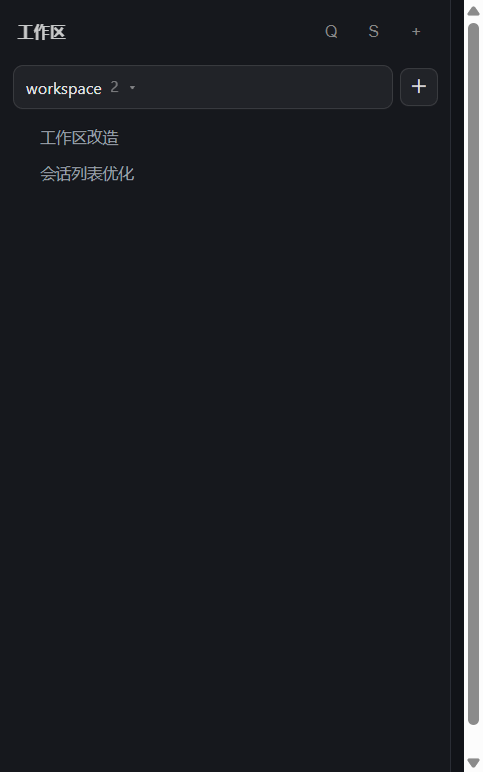
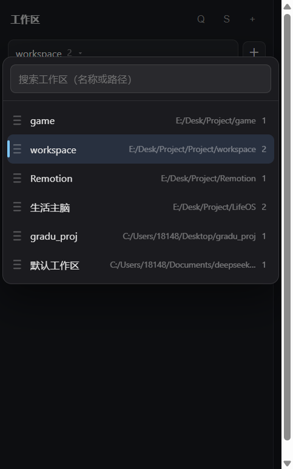

# dsh-workspace-switcher

把 DeepSeek Harness（DSH）侧栏的**工作区列表**变成**只显示当前工作区**的切换器。

> 解决这个问题：工作区一多，侧栏变成一条超长列表，找会话要滚半天。

## 效果

### 侧栏（只显示当前工作区的会话）



### 工作区选择器

点击展开，支持搜索、拖拽排序、右键重命名/删除。



---

## 功能

| 功能 | 说明 |
|---|---|
| **只显示当前工作区** | 其他工作区的会话不再堆积在侧栏 |
| **弹窗切换** | 点选择器弹出工作区列表 |
| **搜索** | 按名称或路径过滤 |
| **键盘导航** | ↑↓ 选择、Enter 确认、Esc 关闭 |
| **拖拽排序** | 按住左侧 3 杠手柄拖动，越过中线即换位，顺序持久化 |
| **右键菜单** | 重命名（查重）/ 复制路径 / 删除工作区（带确认） |
| **新建会话** | 点 `＋` 在当前工作区创建 |
| **双向同步** | 在 DSH 原生下拉切换时，插件自动跟随 |

## 安装

### 方式一：npm（推荐）

```bash
cd $DSH_HOME/profiles/web
npm install dsh-workspace-switcher
```

### 方式二：下载 tgz

```bash
curl -L -o dsh-workspace-switcher.tgz \
  https://github.com/Xiashano1/dsh-workspace-switcher/releases/latest/download/dsh-workspace-switcher-2.6.0.tgz

cd $DSH_HOME/profiles/web
npm install /path/to/dsh-workspace-switcher.tgz
```

### 方式三：手动拷贝（不用 npm）

```bash
tar -xzf dsh-workspace-switcher-2.6.0.tgz
cp -r package $DSH_HOME/profiles/web/node_modules/dsh-workspace-switcher
```

### 注册（所有方式都要）

在 `$DSH_HOME/profiles/web/cordis.patch.yml` 里加：

```yaml
- insert:
    - id: dsh-workspace-switcher
      name: 'dsh-workspace-switcher'
      config:
        enabled: true
```

重启 DSH 生效。

## 配置

| 选项 | 类型 | 默认 | 说明 |
|---|---|---|---|
| `enabled` | boolean | `true` | 是否启用。改成 `false` 可临时关闭，恢复原生侧栏 |

## 使用

| 操作 | 效果 |
|---|---|
| 点选择器 | 打开工作区列表弹窗 |
| 弹窗里输入 | 搜索工作区（名称/路径） |
| 选一个工作区 | 切过去，打开它已有的第一个会话 |
| 点 `＋` | 在当前工作区新建会话 |
| 按住左侧 3 杠拖动 | 调整顺序（越过中线即换位，自动保存） |
| 右键工作区 | 重命名 / 复制路径 / 删除 |

### 排序手感

拖动时：

- 原位置**留空**（不淡化，仍占位）
- 整行副本**跟随光标**，完全不透明
- 光标越过其他行的**中线**时，那行立即滑动到你的位置，你占它的位置
- 其他行用 FLIP 动画平滑让位

---

## ⚠️ 兼容性与已知限制

### 依赖 DSH 内部实现，升级 DSH 后可能失效

**这不是官方接口**，全靠 DOM 结构约定：

| 依赖项 | 用途 | 失效后果 |
|---|---|---|
| `[data-sidebar-workspace-header]` | 定位标题栏 | 选择器不显示 |
| `[data-sidebar-list-area]` | 定位列表容器 | 无法隐藏其他工作区 |
| `[data-row-key="workspace:*"]` | 识别工作区行 | 全部功能失效 |
| `[class*="groupSection"]` | 定位分组容器 | 隐藏失效 |
| `localStorage['dsh.workspace.view.v5']` | 读/写展开状态 | 会话不显示 |

**已验证版本：DSH `0.2.2-rc.3`**

### 失效时会发生什么

**不会崩溃，也不会破坏原生功能。** 插件会：

1. 左下角弹出提示横幅：「工作区切换器未生效」
2. 列出具体缺了哪个 DOM 元素
3. 原生侧栏完全不受影响，照常使用

### 排查方法

在 DSH 页面 URL 后加 `?dws-debug=1`，然后控制台运行：

```js
window.__DSW_DIAG__()
```

### 临时关闭

在 `cordis.patch.yml` 里改成 `enabled: false`，重启 DSH。

### 不会做的事

- 不删除任何会话或文件
- 不修改原生侧栏的搜索/排序/新建功能
- 不改 DSH 配置（除 `cordis.patch.yml` 注册外）

---

## 更新日志

详见 [CHANGELOG.md](CHANGELOG.md)。

## License

MIT
